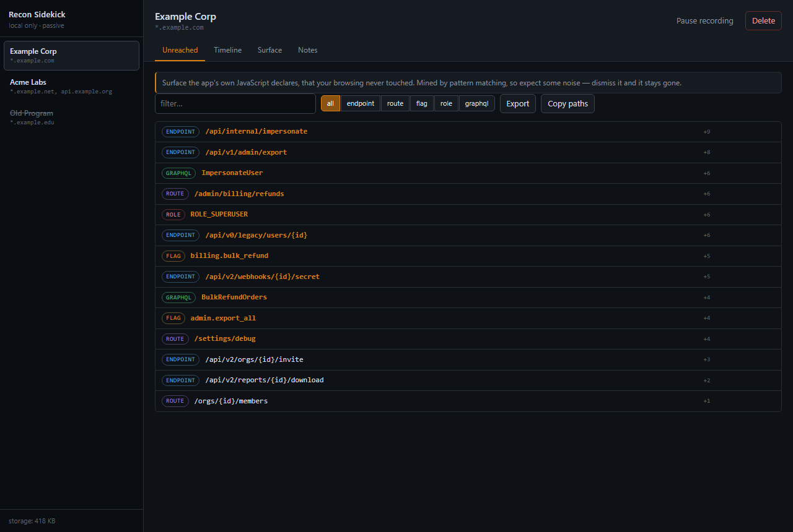
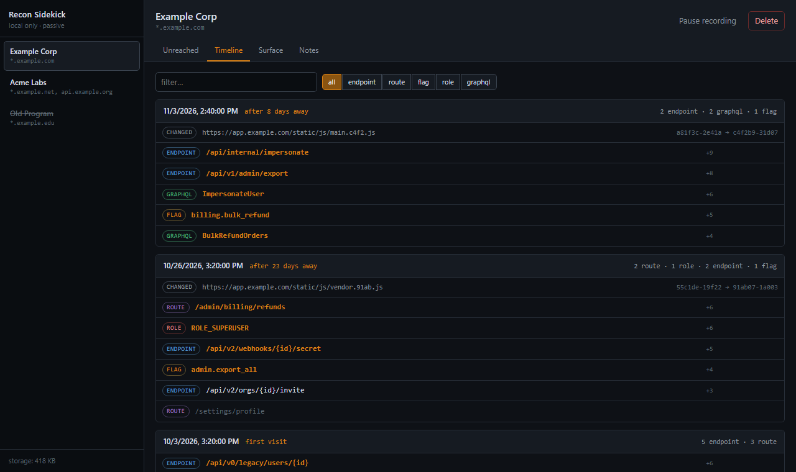

# Recon Sidekick

A Chrome extension that keeps a durable, local memory of a bug bounty target's client
surface — and shows you the two things no other tool does.



*Unreached — surface the app's own JavaScript declares that your browsing never touched,
sorted by how interesting it looks.*



*Timeline — what appeared and what changed on each visit, including bundle hash changes.*

> Screenshots show the real UI rendered with **sample data** via `tools/preview.html`.
> The hostnames are reserved example domains; no real target was tested to produce them.

## Why

Every tool in a manual hunter's kit is stateless. Burp's sitemap, endpoint scrapers, DOM
analysis — they all show you *this* session. Nothing remembers a target across months.

So two useful questions go unanswered:

**"What changed since I was last here?"** You test a target in March, come back in June,
and start from zero. New code is under-tested code; being first to it is how hunters get
paid.

**"What have I never touched?"** An app's JavaScript names the routes and endpoints it
knows about — including ones no button on screen will take you to. The gap between what
the app *declares* and what you *actually exercised* is where access-control bugs live.
No tool puts that list in front of you.

Recon Sidekick answers both by watching your own normal browsing.

## What it does

- **Timeline** — per target, reverse-chronological. *Last seen 23 days ago. +3 endpoints,
  1 new feature flag, `main.a81f.js` changed.*
- **Unreached** — surface mined from the bundle that your browsing never reached, sorted
  by how interesting it looks. The headline view.
- **Surface** — the full searchable inventory, exportable to JSON or line-per-value for
  wordlists.
- **Notes** — free text per target, because findings-in-progress need somewhere to live.

## What it does not do

It is a notebook, not a scanner.

- It never sends a request to a target. The only fetch it performs is a cache re-read of
  JavaScript the browser already downloaded.
- It records nothing on hosts you have not explicitly armed.
- It stores no request bodies, no response bodies, no header values, no cookie values,
  and no query parameter values — parameter *names* only.
- Everything is local. No backend, no account, no sync.

## Install

```
git clone <this repo>
cd recon-sidekick
node tools/make-icons.mjs      # icons are generated, not checked in as blobs
```

Then in Chrome: `chrome://extensions` → enable **Developer mode** → **Load unpacked** →
select the `recon-sidekick` directory.

Requires Chrome 111+ (for `world: "MAIN"` dynamic content script registration).

## Use

1. Browse to a target and click the toolbar icon. It will say **not armed**.
2. Name the program, confirm the host pattern (`*.target.com`), and arm it. Chrome will
   ask for permission on exactly those hosts.
3. The page reloads and recording starts. Browse the target the way you normally would.
4. Open the dashboard. **Unreached** is where to look first.
5. Dismiss noise as you see it — mined rows you dismiss stay gone for that target.

Come back in a few weeks and the popup will tell you what moved.

## How it works

Five pieces:

- **Scope store** (`src/background/programs.js`) — armed programs in `chrome.storage.local`.
  Content scripts are *not* declared in the manifest; they are registered dynamically for
  armed origins only, so the extension has no ability to observe anything else.
- **Page agent** (`src/agent/page-agent.js`) — MAIN-world script that wraps `fetch` and
  `XMLHttpRequest` and listens to history events. Written so it cannot break a host page:
  every wrapper passes through untouched and swallows its own errors.
- **Collector** (`src/background/collector.js`) — normalizes, dedupes, persists. All
  privacy invariants are enforced here.
- **Miner** (`src/background/miner.js`, `src/lib/mine.js`) — pattern-mines JS bundles for
  declared surface.
- **UI** — popup for the glance, dashboard for the work.

### Two design decisions worth knowing

**Normalization is load-bearing.** `/api/users/8821` and `/api/users/9910` collapse to
`/api/users/{id}`. Without that the timeline is thousands of near-duplicate rows and the
tool is worthless.

**The diff is derived, not snapshotted.** Each observation is stored once with
`firstSeen`/`lastSeen`; session boundaries are stored per target. "New since last time" is
then a query — observations whose `firstSeen` lands after the previous session ended. No
snapshot history and no unbounded storage growth.

## Known limits (v1)

- **Service worker and WebSocket traffic are not observed.** A page-context `fetch`
  wrapper cannot see either. Real blind spots, not papered over.
- **Mining is pattern-based, so it is noisy.** That was a deliberate trade: the diff and
  timeline — where the value is — work identically regardless of extraction precision.
  AST parsing is the planned upgrade if the noise proves expensive in real use.
- **Local only.** The timeline lives on one machine and one profile.

## Develop

```
npm test              # 64 tests, no dependencies
node tools/serve.mjs  # then open http://localhost:8731/tools/preview.html
```

`tools/preview.html` loads the real dashboard code against fixture data, which makes it
useful for working on the UI without arming a live target. Append `?view=timeline`
(or `surface`, `notes`) to open a specific tab.

Pure logic lives in `src/lib/` and is fully unit tested — normalization, the rule pack,
and the diff engine. The page agent has an integration test that runs the real file in a
`vm` context and asserts it does not alter what a page receives.

Design doc: `docs/superpowers/specs/2026-11-03-recon-sidekick-design.md`

## Use it legally

Only point this at targets you are authorized to test. It is passive, but scope is your
responsibility — the arming step exists partly to make you state it deliberately.

## License

MIT — see [LICENSE](LICENSE).
